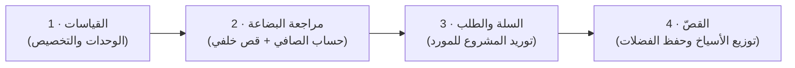

<div align="center">

# 📐 مِقْيَاس (Meqyas)

**منصة هندسية متكاملة لإدارة ورش ومعامل الألمنيوم والزجاج، تحسين القصّ وتقليل الهدر، وإدارة التوريد والموردين**  
*Smart Aluminum & Glass Fabrication, 1D Cut Optimization, Remnants & Supply Chain Platform*

<p>
  
  
  
  
  
  
  
</p>

[دليل المطور والوكلاء الذكيين (`PROJECT_HANDOFF.md`)](./PROJECT_HANDOFF.md) • [مسار العمل](#-مسار-العمل-داخل-المشروع-4-step-workflow) • [المحرك الهندسي](#-المحرك-الهندسي-maqyas_engine) • [التشغيل والاختبار](#-التشغيل-والاختبار-getting-started)

</div>

---

## 📋 جدول المحتويات

1. [نظرة عامة](#-نظرة-عامة)
2. [مسار العمل داخل المشروع (4-Step Workflow)](#-مسار-العمل-داخل-المشروع-4-step-workflow)
3. [البوابات والأدوار الثلاثة](#-البوابات-والأدوار-الثلاثة)
4. [المحرك الهندسي (`maqyas_engine`)](#-المحرك-الهندسي-maqyas_engine)
5. [خوارزمية القصّ، الألوان، والفضلات](#-خوارزمية-القص-الألوان-والفضلات)
6. [معمارية العمل بدون إنترنت (Offline-First)](#-معمارية-العمل-بدون-إنترنت-offline-first)
7. [التقنيات وهيكل المشروع](#-التقنيات-وهيكل-المشروع)
8. [التشغيل والاختبار (`Getting Started`)](#-التشغيل-والاختبار-getting-started)
9. [بيانات الدخول التجريبية](#-بيانات-الدخول-التجريبية)
10. [خريطة التطوير (Roadmap)](#-خريطة-التطوير-roadmap)

---

## 🌟 نظرة عامة

تم بناء **مِقْيَاس (Meqyas)** لمعالجة التحديات اليومية في ورش تصنيع الألمنيوم والزجاج:

- **تحويل القياسات آلياً:** إدخال قياس الفتحة (`W × H`) وتوليد أطوال القطاعات، ألواح الزجاج، الشبك، والإكسسوارات بدقة تامة.
- **تخصيص على مستوى المشروع وكل شباك:** خصائص افتراضية للمشروع (`ProjectDefaults`) مع إمكانية تخصيص كل وحدة على حدة (اللون، نوع الزجاج، نوع/عرض الشبك، الدواليب، الزوايا، الجوان، والمعجونة).
- **تحديث تلقائي صامت بدون إعادة تحميل يدوي:** أي تعديل في القياسات أو الألوان أو مخزن الفضلات يُعيد حساب متطلبات البضاعة وخطة القصّ تلقائياً.
- **عزل كامل للألوان:** لا تستهلك الوحدة البيضاء فضلات سوداء أو برونزية، ولا تختلط الألوان في خطط القص أو كشوف البضاعة.
- **معمارية Offline-First:** عمل كامل في مواقع البناء المنقطعة عن الشبكة مع مزامنة تلقائية فور عودة الاتصال.

---

## 🔄 مسار العمل داخل المشروع (4-Step Workflow)

يتبع المشروع تسلسلاً عملياً من **4 خطوات مترابطة** عبر `ProjectStepperBar`:



| الخطوة | الشاشة | الدور الأساسي |
|---|---|---|
| **1 · القياسات** | `ProjectDetailScreen` | إضافة/تعديل الشبابيك والأبواب والواجهات، القياسات الفورية (Debounced)، وتخصيص الإكسسوارات والشبك لكل شباك. |
| **2 · مراجعة البضاعة** | `ProjectRequirementsScreen` | تشغيل `CutOptimizer` في الخلفية لخصم الفضلات المتوفرة (بنفس المقطع واللون)، إدخال المتوفر بالمخزن، وتصدير PDF للاحتياجات. |
| **3 · السلة والطلب** | `CartScreen` | سلة خاصة ببنود المشروع لطلب التسعير والتوريد من المورد (داخل التطبيق أو عبر واتساب). |
| **4 · القصّ** | `CutPlanScreen` | عرض مخطط القصّ سيخاً بسيخ، توضيح اتجاهات منخل `عامودي`/`أفقي`، واعتماد التنفيذ عبر زر **`قص`** لتحديث مخزن الفضلات. |

---

## 👥 البوابات والأدوار الثلاثة

### 1. بوابة صاحب الورشة (`OwnerDashboardScreen`)
- **4 تبويبات مدمجة في لوحة واحدة:** `المشاريع والقياسات` · `التوريد والموردين` · `أدوات وإعدادات الورشة` · `مخزن الفضلات`.
- **استيراد Excel (`.xlsx`):** استيراد مقايسات مشاريع كاملة ومزامنة الكتالوج.
- **تخصيص القواعد بأمان (`Locked Formula Editor`):** تعديل خصومات الورشة ضمن نطاق آمن ($\pm 50\%$) مع الحفاظ على بنية المعادلة.
- **ماسح وملصقات QR:** توليد جداول PDF وملصقات QR للقطع مع ماسح كاميرا مدمج.

### 2. بوابة المورد (`SupplierPortal`)
- استقبال طلبات التسعير من الورش مع تفاصيل الأصناف والكميات.
- تسعير تفاعلي: تحديد التوفر، تعديل الكميات، وإدخال الأسعار والملاحظات لتتبع الطلب (`مُرسل` ← `مُسعّر` ← `مُعتمد` ← `قيد التجهيز` ← `مكتمل`).

### 3. بوابة مدير النظام (`AdminPortal`)
- تفعيل حسابات الورش والموردين الجدد بضغطة واحدة (`1-Tap Activation`).
- إدارة أنظمة القطاعات والمعادلات مع `RuleValidator` و`ConflictDetector` و`RuleSandbox`.
- إدارة الكتالوج المرجعي وسجلات التدقيق (`Audit Logs`).

---

## 🧠 المحرك الهندسي (`maqyas_engine`)

حزمة Dart نقية ومستقلة تماماً في [`packages/maqyas_engine`](./packages/maqyas_engine) بدون أي اعتماد على Flutter أو Firebase:

```text
packages/maqyas_engine/lib/src/
├── ast/        # محلل ومفسر المعادلات النصية (AST Tokenizer & Evaluator)
├── graph/      # الترتيب الطوبولوجي وكشف الاعتماد الدائري (Kahn's Algorithm)
├── models/     # نماذج الوحدات، القواعد، القطع، وتوحيد الألوان والمقاطع
├── rules/      # SeedRules (نظام 2000)، RuleValidator، ConflictDetector، RuleSandbox
├── engine/     # CalculatorEngine (القطاعات، الزجاج، والإكسسوارات)
└── optimizer/  # CutOptimizer (1D FFD + Remnant-First) و MeshOptimizer (2D)
```

---

## 🪚 خوارزمية القصّ، الألوان، والفضلات

- **استراتيجية الفضلات أولاً (`Remnant-First` + `FFD`):** البحث في فضلات الرف المتاحة قبل فتح قضيب جديد (`660 سم`)، مع احتساب هالك البداية (`4 سم` للقضيب الجديد و`0 سم` للفضلات)، هالك المنشار (`0.5 سم`)، واعتبار الباقي $\ge 50\text{ سم}$ فضلة صالحة لإعادة الاستخدام.
- **توحيد مقطع درفة المنخل (`screen_sash`):** تبقى قاعدتا `screen_vertical` (`درفة منخل عامودي`) و`screen_horizontal` (`درفة منخل أفقي`) منفصلتين في المعادلات، بينما يجمعهما المحرك والمشتريات على **نفس قضيب `درفة منخل`** (بنفس اللون) مع إبقاء وسم **`عامودي`** / **`أفقي`** ظاهراً على كل قطعة قصّ.
- **مطابقة الألوان الصارمة (`normalizeProfileColor`):** توحيد أسماء الألوان العربية والإنجليزية وعزل القصّ والفضلات وقضبان الألمنيوم والإكسسوارات الظاهرة (المسكات والطبات) وفراشة الشبك حسب اللون.

---

## 📶 معمارية العمل بدون إنترنت (`Offline-First`)

1. **تخزين محلي مستمر (`Firestore SQLite Persistence`)** للمشاريع والوحدات والقواعد والفضلات والطلبات.
2. **عمليات كتابة غير حاجبة (`OfflineFirestoreHelper`)** تمنح استجابة فورية دون انتظار السحابة.
3. **خطوط `Cairo` مدمجة محلياً** دون أي اعتماد شبكي خارجي.
4. **قفل الجلسة للجهاز الواحد (`activeSessionId`)** لمنع تعارض تعديلات الورشة بين جهازين.

---

## 💻 التقنيات وهيكل المشروع

- **Frontend:** Flutter (`Dart ^3.13.5`) · Riverpod (`^3.4.3`) · GoRouter (`^18.1.0`)
- **Backend:** Firebase (`meqyas-app-2026`: Auth, Cloud Firestore, Cloud Functions, Cloud Storage)
- **Utilities:** `pdf`, `printing`, `mobile_scanner`, `excel`, `file_picker`, `url_launcher`

```text
meqyas/
├── lib/
│   ├── app/                  # Router & Themes
│   ├── core/                 # Offline Firestore & Sync Widgets
│   └── features/             # admin, auth, cart, catalog, cut_optimization, cut_scanner,
│                             # dashboard, home, inventory, orders, pricing, projects,
│                             # reports, requirements, rules, supplier_portal, suppliers
├── packages/maqyas_engine/   # Pure-Dart Engine & Optimizers
├── functions/                # Firebase Cloud Functions
├── scripts/                  # Emulators & Seed Scripts (seed_cloud.mjs, seed_rules.ts)
├── test/                     # Flutter Unit & Widget Tests
├── firestore.rules           # Firestore Security Rules
└── PROJECT_HANDOFF.md        # Technical Handoff & AI Agent Guide
```

---

## 🚀 التشغيل والاختبار (`Getting Started`)

### المتطلبات
- [Flutter SDK](https://docs.flutter.dev/get-started/install) (`Dart >= 3.13.5`)
- [Firebase CLI](https://firebase.google.com/docs/cli) (اختياري للمحاكيات والنشر)

### التثبيت والتحقق
```bash
# 1. استنساخ المستودع
git clone https://github.com/Hasanakramprog/meqyas.git
cd meqyas

# 2. تثبيت الاعتماديات
flutter pub get
cd packages/maqyas_engine && dart pub get && cd ../..

# 3. تشغيل اختبارات المحرك الهندسي (30 اختبار)
cd packages/maqyas_engine && dart test && cd ../..

# 4. الفحص الساكن واختبارات Flutter (27 اختبار)
flutter analyze
flutter test

# 5. تشغيل التطبيق
flutter run
```

### تشغيل محاكيات Firebase المحلية (اختياري)
```bash
./scripts/start_emulators.sh
```

---

## 🔑 بيانات الدخول التجريبية

المشروع مربوط بسحابة Firebase (`meqyas-app-2026`) مع حسابات جاهزة للتجربة:

| الدور | البريد الإلكتروني | كلمة المرور | الصلاحيات |
| :--- | :--- | :--- | :--- |
| **صاحب الورشة (Owner)** | `owner@meqyas.com` | `Owner123` | المشاريع، البضاعة، السلة، خطط القص، الفضلات، والطلبات |
| **المورد (Supplier)** | `supplier@meqyas.com` | `Supplier123` | استقبال طلبات التوريد، التسعير التفاعلي، وتحديث الحالات |
| **مدير النظام (Admin)** | `admin@meqyas.com` | `Admin123` | تفعيل المستخدمين، اعتماد القواعد والأنظمة، وإدارة الكتالوج |

---

## 🗺️ خريطة التطوير (`Roadmap`)

- [x] **المراحل 1–6:** المحرك الهندسي، تحسين القصّ 1D/2D، مخزن الفضلات، والربط مع الموردين.
- [x] **المرحلة 7:** إدارة وتفعيل المستخدمين ولوحة الأدمن والربط السحابي.
- [x] **المرحلة 9:** معمارية العمل بدون إنترنت (`Offline-First`) وقفل الجلسة للجهاز الواحد.
- [x] **المرحلة 10:** إعادة ترتيب مسار العمل (1 ← 2 ← 3 ← 4)، التخصيص لكل وحدة، التحديث التلقائي للفضلات، عزل الألوان، وتوحيد مقطع درفة المنخل.
- [ ] **القادم:** الإشعارات الفورية (`Push Notifications`)، عروض أسعار PDF لعملاء الورشة، ولوحة تقارير وإحصائيات الورشة.

---

<p align="center">
  صُنع بـ ❤️ لخدمة وتطوير قطاع صناعة وتجارة الألمنيوم والزجاج.
</p>
