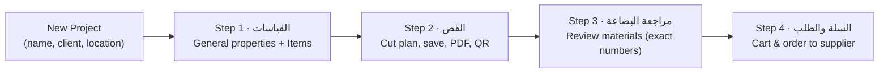

# Phase 10: New Project Flow, Project-Level Defaults & Admin-Managed Item Types

## 1. Goal (in one paragraph)

Change the project flow to a **4-step wizard** (cut first, then requirements, so the numbers are always exact). In **Step 1 (القياسات)** the owner first sets **general project properties once** (aluminum system, color, glass type, glass thickness, glass gasket, deductions). Every item added afterwards **inherits** these values. Any item can **override** them and can **reset to default** with one tap. Item types (today only *window* and *facade*) become **data managed by the Admin**: the Admin adds a new item type, links it to calculation rules, and it instantly appears in the owner's "add item" selection.

---

## 2. Target Flow



| Step | Arabic | What the user does | Existing code we reuse |
| :-- | :-- | :-- | :-- |
| 1 | القياسات | Set project defaults, add/edit items | `project_detail_screen.dart`, `unit_editor_screen.dart`, `quick_entry_sheet.dart` |
| 2 | القص | Optimize bars with shelf remnants, save plan, PDF, QR | `cut_plan_screen.dart`, `CutOptimizer` |
| 3 | مراجعة البضاعة | Review required bars, glass, accessories, stock (based on the **saved** cut plan) | `project_requirements_screen.dart` |
| 4 | السلة والطلب | Pick supplier, send order (in-app / WhatsApp / PDF) | `orders_repository.dart`, requirements dialogs |

> **Decision made:** the current order is kept (cut first, then requirements). The "bars to buy" number always comes from the saved cut plan, so it is exact. The visual order of the 4 chips changes from the first screenshot; the Arabic labels stay the same.

### Settings hierarchy (the core idea)

```
Global rule (Admin)  →  Workshop override  →  Project default  →  Item override
      weakest                                                          strongest
```

An item's **effective value** = the strongest layer that has a value. **"Reset to default"** simply deletes the item-level (or project-level) value so the layer below shows through again.

---

## 3. Data Model Changes

### 3.1 Project defaults (new field on `Project`)

```jsonc
// workshops/{wid}/projects/{pid}
{
  "defaults": {
    "profileSystemId": "system_2000_beaded",   // "ألمنيوم الورشة"
    "color": "white",                           // "لون الورشة الافتراضي للوحدات"
    "glassType": "clear",                       // "نوع زجاج المشروع"
    "glassThicknessMm": 6,                      // "سماكة زجاج المشروع"
    "hasGlassGasket": false,                    // "الزبون يبدك كوتشوك الزجاج"
    "deductions": { "kaab": "-1.5", "track": "-3" }   // project-level formula constants (التخسيمات)
  }
}
```

### 3.2 Item override (sparse map on `ProjectUnit`)

```jsonc
// .../projects/{pid}/units/{uid}
{
  "itemTypeId": "window",
  "widthCm": 200, "heightCm": 150, "quantity": 2,
  "overrides": { "glassType": "frosted", "glassThicknessMm": 8 }   // ONLY customized keys
}
```
Empty or missing key = "uses project default". Reset = remove key.

### 3.3 Item types (new Admin-managed collection)

```jsonc
// itemTypes/{itemTypeId}
{
  "code": "window",
  "nameArabic": "شباك",
  "icon": "window",
  "status": "active",              // active | hidden
  "sortOrder": 1,
  "visibleFields": ["sashCount", "hasScreen", "glazingMode", "sharhOption"],
  "customFields": [                // Phase 5
    { "key": "mullionCount", "labelAr": "عدد الفواصل", "type": "int", "default": 0 }
  ]
}
```

### 3.4 Rule ↔ item type link

Add `itemTypeId` (string, default `"*"` = all types) to `CalculationRule`. The `RuleSelector` filters by `itemTypeId` **in addition to** `profileSystemId` and `conditions`.

---

## 4. Phases

> Each phase is shippable on its own, keeps `flutter analyze` at 0 issues, and keeps all current tests green.

### Phase 1 — Foundation + Step 1 "General Project Properties"

**Goal:** Wizard shell + project defaults screen exactly like the screenshots.

- Add `ProjectDefaults` model and `defaults` field to [`Project`](../lib/features/projects/domain/models/project.dart) (with safe fallbacks for old projects).
- New widget `ProjectStepper` (4 chips: القياسات · القص · مراجعة البضاعة · السلة والطلب) shown at the top of the project screen; steps 2–4 deep-link to existing screens for now.
- New card **"الخصائص العامة للمشروع"** at the top of Step 1:
  - ألمنيوم الورشة (profile system dropdown)
  - لون الورشة الافتراضي للوحدات
  - نوع زجاج المشروع · سماكة زجاج المشروع · الزبون يبدك كوتشوك الزجاج
- New-project dialog gets the same fields (pre-filled from the workshop's last project).
- `ProjectsRepository.updateProjectDefaults()` using the offline-safe helpers from Phase 9.

**Done when:** creating a project stores `defaults`; changing a default is saved offline and online; old projects open without errors.

### Phase 2 — Items inherit, override, auto-name (`شباك 1`, `واجهة 1`) and start at `0×0`

**Goal:** Defaults apply to all items; new items auto-increment their name per type and start with `0` width/height; any item can be customized and reset.

- **Per-type auto-incrementing name:** When adding a new item, count existing items of the **same `itemTypeId`** in the project and name it `<typeName> <count + 1>`:
  - 1st window → `شباك 1`, 2nd window → `شباك 2`, …
  - 1st facade → `واجهة 1`, 2nd facade → `واجهة 2`, …
  - Works automatically for any new Admin-created item type (e.g., `باب 1`, `باب 2`).
- **Initial Width & Height start at `0`:** New items initialize with `width = 0` and `height = 0` (removing the old `1000×1200` pre-fill in [`unit_editor_screen.dart`](../lib/features/projects/presentation/screens/unit_editor_screen.dart) and [`quick_entry_sheet.dart`](../lib/features/projects/presentation/screens/quick_entry_sheet.dart)); saving requires entering a valid measurement `> 0`.
- Add pure-Dart resolver in `maqyas_engine`: `EffectiveSpecResolver.resolve(projectDefaults, unit)` → `UnitSpecification` (unit-testable).
- `ProjectUnit.toEngineSpec()` now takes `ProjectDefaults` and merges `overrides`.
- Unit editor: each inherited field shows a small **"افتراضي المشروع"** tag; editing a field turns it into **"مخصص ✎"** and shows a **"استرجاع الافتراضي ↺"** button (per field) plus **"استرجاع كل الإعدادات"** (per item).
- Items list shows a badge when an item has overrides.
- Changing a project default re-calculates all items that did not override that field (automatic, because they read the default live).
- **Deductions layer (التخسيمات):** extend `RulesRepository.watchEffectiveRules` to merge `workshop override → project deductions → item deductions`; section **"تعديل التخسيمات / استرجاع الافتراضي"** reuses the existing locked-formula editor (±50 % guard) at project and item level.

**Done when:** unit tests prove inherit / override / reset for every field, per-type auto-naming (`شباك 1`, `شباك 2`, `واجهة 1`), and `0×0` initial dimensions; cut list of an item changes immediately when its override is set or reset.

### Phase 3 — Admin Item Types catalog

**Goal:** Admin controls which item types exist; owner's selection becomes dynamic.

- Seed `itemTypes/window` and `itemTypes/facade` (migration script in `scripts/`), so nothing changes for existing data.
- New admin screen **"إدارة أنواع العناصر"** (`/dashboard/admin/item-types`): add / edit / hide / reorder, name, icon, visible fields. Add a card in `AdminDashboardScreen`.
- `ItemTypesRepository` + `itemTypesProvider` (stream, cached offline, warm-up in `OfflineSyncShell`).
- Replace the hard-coded `SegmentedButton(window | facade)` in [`quick_entry_sheet.dart`](../lib/features/projects/presentation/screens/quick_entry_sheet.dart) and the unit editor with a selector built from `itemTypesProvider`.
- `ProjectUnit` gets `itemTypeId`; keep `unitType` as a computed alias for old data and the drawing canvas.
- **Firestore rules:** `itemTypes` readable by any signed-in user, writable by Admin only — **must be authored through the `firestore-rules-author` subagent** and deployed to `meqyas-app-2026`.

**Done when:** Admin adds "باب سحاب" → it appears in the owner's selection without an app update.

### Phase 4 — Rules bound to item types

**Goal:** Each item type calculates with its own rules.

- Add `itemTypeId` to `CalculationRule` (map, copyWith, toMap/fromMap, default `*`).
- `RuleSelector`: filter by `itemTypeId` (`*` matches all); `ConflictDetector` and `RuleValidator` become item-type aware.
- Add variable `itemType` to `UnitSpecification.toEnvironment()` for conditions such as `itemType == 'door'`.
- Admin rules screen: new **item type filter + field** on the rule editor; rule list grouped by item type; clear message when a type has no rules ("لا توجد قواعد لهذا النوع — لن يتم حساب القص").
- Existing seed rules are tagged `*` (or `window`) so current projects calculate identically — add regression test comparing old vs new output.

**Done when:** a new item type with its own rule set produces its own cut list; windows still match the existing test vectors (W=120, H=150).

### Phase 5 — Dynamic fields per item type

**Goal:** Admin decides which properties each item type asks for.

- `visibleFields` controls which built-in fields (sashCount, hasScreen, glazingMode, …) the editor shows.
- `customFields` (int / double / select / bool) are rendered dynamically in the unit editor and stored in `ProjectUnit.customOptions`, which already flows into the formula environment (`UnitSpecification.customOptions`).
- Admin field editor inside the item-type screen (key must be `[a-zA-Z0-9_]`, validated by `RuleValidator` so formulas can safely use it).
- Custom fields support project default + item override + reset like built-in ones.

**Done when:** Admin adds a `mullionCount` field to "facade", a rule uses it, and the owner sees the field and the cut list reacts.

### Phase 6 — Wire Steps 2–4, migration, QA

**Goal:** One smooth flow from new project to cut.

- Step 2 **القص** = cut plan + PDF + QR; Step 3 **مراجعة البضاعة** = requirements review; Step 4 **السلة والطلب** = supplier order dialogs. Navigation with "التالي / السابق" and a completed-step check mark.
- Step 3 is locked until the cut plan is saved in Step 2 (message: "احفظ خطة القص أولاً لحساب المطلوب شراؤه بدقة").
- Stale-state guard: when measurements change after later steps were done, show the existing "recalculate" banner on steps 2–4.
- Migration script for old projects (`defaults` filled from the first unit; `itemTypeId` from `unitType`).
- Tests: engine (resolver, selector), repository, widget test for the stepper; manual test sheet in this folder; offline scenario re-test (Phase 9).
- Update `README.md` and the client report.

**Done when:** full demo path works on **sam’s iPhone** online and in airplane mode.

---

## 5. Decisions Needed Before Starting

1. ~~**Step order.**~~ **Decided:** keep cut first, then requirements (exact numbers, no preview logic).
2. **Deductions scope.** Should project/item deductions also use the ±50 % locked-formula guard? (Proposal: yes, same rule as workshop.)
3. **Changing a project default later.** Items that did not override follow the new value automatically (proposal) — or ask for confirmation first?
4. **Item type deletion.** Proposal: Admin can only **hide** a type (never delete) so old projects keep working.

## 6. Risks

| Risk | Mitigation |
| :-- | :-- |
| Old projects without `defaults` / `itemTypeId` | Safe fallbacks in `fromFirestore` + migration script |
| New item type without rules shows empty cut list | Clear warning in unit editor and admin screen |
| Rule changes alter existing results | Regression tests on current vectors before/after Phase 4 |
| Offline-first behavior | Use `OfflineFirestoreHelper` for every new write and cache `itemTypes` in warm-up |

## 7. Suggested Order & Effort

| Phase | Effort | Visible result |
| :-- | :-- | :-- |
| 1 | S | Wizard bar + project general properties card |
| 2 | M | Items follow defaults, per-item override and reset |
| 3 | M | Admin manages item types |
| 4 | M | Rules per item type |
| 5 | M | Admin-defined fields per item type |
| 6 | S–M | Smooth 4-step flow, migration, QA |

Recommended start: **Phase 1 → Phase 2** (what the client sees first), then Admin phases 3–5.

