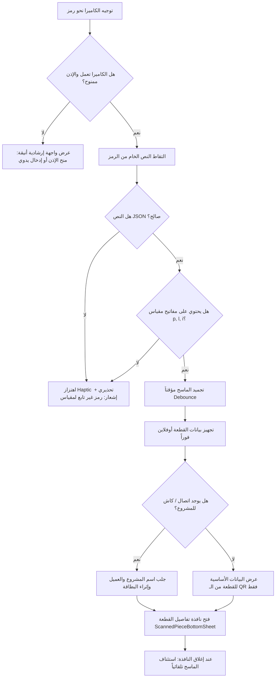

# خطة تنفيذ ماسح رموز QR للقطع المقصوصة (QR Cut Piece Scanner)
## Offline & Online Resilient Architecture — مقياس

**الملف المستهدف:** `updates-md/qr_piece_scanner_plan.md`  
**الهدف:** تمكين المعلم وفنيي الورشة من مسح ملصقات الـ QR المثبتة على بروفيلات الألمنيوم المقصوصة للتعرف الفوري على هوية القطعة، أبعادها، مشروعها، ونافذتها في بيئة الورشة الواقعية (أونلاين أو بدون إنترنت)، مع حماية تامة ضد انهيار التطبيق (Zero-Crash Architecture).

---

## 1. التحديات والمتطلبات الأساسية

| التحدي | الحل المعتمد |
|---|---|
| **العمل بدون إنترنت (Offline في الورشة)** | فك تشفير البيانات المشفرة ذاتياً داخل الـ QR مباشرة (`Self-Contained Payload`)، وعرض الطول، اسم القطعة، النافذة، ورقم القضيب فورياً دون الحاجة لأي اتصال بالشبكة. |
| **الإثراء عند توفر الإنترنت (Online Enrichment)** | إذا توفر الاتصال أو كانت البيانات مخزنة في كاش Firestore المحلي، يتم إثراء البطاقة باسم المشروع، واسم العميل، وزر تفاعلي للانتقال الفوري لملف المشروع. |
| **حماية التطبيق من الانهيار (Crash Prevention)** | معالجة شاملة لأي خطأ محتمل: عدم توفر الكاميرا (في المحاكي Emulator)، رفض إذن الكاميرا، مسح رمز QR عشوائي خارجي (Wi-Fi أو موقع)، أخطاء JSON، أو الرموز التالفة. |
| **منع التكرار (Scan Debounce & Queue)** | تجميد الماسح تلقائياً عند أول قراءة صحيحة لمنع فتح عشرات النوافذ المنبثقة متتالية، وإعادة تفعيله بسلاسة عند إغلاق النافذة أو النقر على "مسح قطعة أخرى". |
| **واجهة مستخدم احترافية (Modern UI/UX)** | نافذة ماسح متطورة مع خط مسح ليزري متحرك، زر تشغيل الفلاش (Torch)، وزر التبديل بين الكاميرات، مع بطاقة منبثقة غنية (BottomSheet) تدعم العربية RTL. |

---

## 2. بنية البيانات والتوافق العكسي (QR Data Schema)

### أ) النسخة المطورة للـ QR الجديد (Enriched QR Payload - v1)
سنقوم بتطوير [label_generator.dart](file:///Users/macbook/Desktop/codingrepo/meqyas/lib/features/reports/data/label_generator.dart) ليشمل الحقول التالية دون زيادة حجم الرمز:
```json
{
  "v": 1,
  "p": "projectId_abc123",
  "u": "شباك الصالون #1",
  "i": "kaab",
  "n": "كعب 2000 مفرد",
  "l": 58.75,
  "b": 1,
  "c": "white",
  "r": false
}
```
* `v`: إصدار بنية البيانات (Version 1).
* `p`: معرف المشروع (`projectId`).
* `u`: وسم النافذة أو الواجهة (`unitTag`).
* `i`: كود الصنف (`itemCode`).
* `n`: اسم القطعة بالعربية (`nameArabic`) — يضمن القراءة الفورية دون إنترنت.
* `l`: الطول المقصوص الدقيق بالسنتيمتر (`lengthCm`).
* `b`: رقم القضيب المصدر (`barNumber`).
* `c`: لون القطعة (`color`).
* `r`: هل قُصت من فضلة مخزنة (`isFromRemnant`).

### ب) التوافق العكسي مع الملصقات المطبوعة سابقاً (Backward Compatibility)
الملصقات المطبوعة بالنسخة السابقة تحتوي على:
```json
{"p": "projectId", "u": "unitTag", "i": "itemCode", "l": 58.75, "b": 1}
```
سيقوم الـ Parser بالتعرف عليها تلقائياً، واستنتاج الاسم العربي `nameArabic` عبر قاموس محلي مدمج (`Local Fallback Dictionary`) إذا لم يتوفر اتصال بالإنترنت.

---

## 3. المعمارية البرمجية والمكونات الجديدة

```
lib/features/cut_scanner/
├── domain/
│   ├── models/
│   │   └── scanned_piece_info.dart       # الكيان النقي للقطعة المقروءة
│   └── services/
│       └── qr_cut_payload_parser.dart     # معالج فك التشفير والتحقق من صحة الرمز
└── presentation/
    ├── screens/
    │   └── qr_piece_scanner_screen.dart   # شاشة الكاميرا والماسح الضوئي
    └── widgets/
        ├── scanner_overlay_painter.dart   # إطار الماسح والأنيميشن الليزري
        ├── scanned_piece_bottom_sheet.dart# بطاقة عرض تفاصيل القطعة المنبثقة
        └── scanner_error_view.dart        # واجهة معالجة الأذونات أو غياب الكاميرا
```

---

## 4. خطة المعالجة الصارمة للاستثناءات (Zero-Crash Exception Handling)



### حالات الخطأ المعالجة برمجياً:
1. **مسح رمز غريب (مثل شبكة Wi-Fi أو رابط موقع خارجي):**
   - الـ Parser يستخدم `try/catch` محكم لفحص بنية JSON.
   - في حال الفشل: يظهر SnackBar باللون الأصفر الهادئ: *«هذا الرمز ليس ملصق قص خاص بتطبيق مقياس»*، دون توقف الكاميرا.
2. **غياب الكاميرا (في بيئة المحاكي Emulator أو عطل عتادي):**
   - استشعار الخطأ عبر `mobile_scanner errorBuilder`.
   - عرض شاشة بديلة: *«الكاميرا غير متوفرة حالياً»* مع حقل إدخال يدوي لاختبار الأكواد.
3. **رفض إذن الكاميرا (Permission Denied):**
   - إظهار رسالة واضحة بالعربية بزر *«فتح إعدادات الهاتف لمنح الإذن»*.
4. **الاهتزاز السريع أو المسح المتكرر في أجزاء من الثانية:**
   - استخدام متغير حالة `_isProcessing = true` فور أول قراءة صالحة لمنع استدعاء نافذة العرض أكثر من مرة.

---

## 5. تصميم واجهة المستخدم (UI/UX)

### أ) شاشة الكاميرا (`QrPieceScannerScreen`):
- شاشة داكنة كاملة بنسبة تباين عالية لسهولة الرؤية تحت إضاءة الورشة.
- نافذة تركيز دائرية الزوايا في المنتصف مع إطار ذهبي (`AppColors.amberPrimary`).
- مؤشر مسح ليزري متحرك يعطي شعوراً تقنياً احترافياً.
- أزرار تحكم علوية:
  - 🔦 زر الفلاش (`Flash On/Off`) للعمل في زوايا الورشة المظلمة.
  - 🔄 زر تبديل الكاميرا (الأمامية / الخلفية).
  - ❌ زر العودة للرئيسية.

### ب) نافذة تفاصيل القطعة (`ScannedPieceBottomSheet`):
- **رأس البطاقة:**
  - شارة نوع القطعة: `مقصوصة من قضيب خام` أو `مقصوصة من فضلة مخزنة`.
  - اسم القطعة بخط كبير عريض (مثل: `كعب 2000 مفرد`).
- **شريط المقاس البارز:**
  - عرض الطول برقم ضخم واضح: **`58.75 سم`** مع إبراز زوايا الشطف `45° / 45°`.
- **معلومات السياق والمشروع:**
  - 🏢 **المشروع:** اسم المشروع (مع مؤشر `أونلاين` أو `محلي`).
  - 🪟 **النافذة / الموقع:** مثل `شباك غرفة النوم #1 - الدور الأرضي`.
  - ✂️ **رقم القضيب:** قضيب رقم 2 (نظام 2000 بحاجب - أبيض).
- **أزرار الإجراء السريع:**
  - 📂 **«فتح ملف المشروع»**: ينقل المعلم مباشرة لشاشة تفاصيل المشروع المعني.
  - 📷 **«مسح قطعة أخرى»**: يغلق النافذة المنبثقة ويعيد تشغيل الكاميرا فوراً.

---

## 6. نقاط الوصول في التطبيق (Entry Points)

1. **شاشة المعلم الرئيسية (`OwnerDashboardScreen`):**
   - إضافة أيقونة ماسح الكاميرا `Icons.qr_code_scanner_rounded` في الـ `AppBar` العلوي.
2. **شاشة تفاصيل المشروع (`ProjectDetailScreen`):**
   - زر سريع بجوار طباعة المخطط لمسح قطع هذا المشروع تحديداً.
3. **شاشة خطة القص (`CutPlanScreen`):**
   - زر في القائمة السفلية للتحقق من القطع المقصوصة ومطابقتها للمخطط.

---

## 7. المكتبات والتبعيات المطلوبة
- إضافة `mobile_scanner: ^6.0.4` إلى `pubspec.yaml` (أحدث مكتبة رسمية مدعومة لكاميرات أندرويد وiOS بكفاءة عالية واستهلاك منخفض للبطارية).
- تحديث أذونات `AndroidManifest.xml` و `Info.plist` لإضافة وصف إذن الكاميرا باللغة العربية والإنجليزية.

---

## 8. معايير القبول واكتمال الميزة (Definition of Done)

1. ✅ مسح ملصق QR لقطعة مقصوصة يعرض فورياً كافة تفاصيلها (الطول، المقطع، القضيب، النافذة) في أقل من 0.3 ثانية.
2. ✅ العمل بكفاءة تامة 100% دون وجود اتصال بالإنترنت (Offline Mode).
3. ✅ عند توفر الإنترنت، يتم جلب اسم المشروع والعميل وتوفير رابط مباشر لفتح المشروع.
4. ✅ مسح أي رمز عشوائي أو تالف لا يسبب انهيار التطبيق مطلقاً، ويظهر تنبيهاً ودياً بالعربية.
5. ✅ التوافق التام مع الملصقات القديمة والجديدة.
6. ✅ اجتياز فحص الأكواد واختبارات السلامة: `flutter analyze` بنتيجة (0 issues) و `flutter test`.
